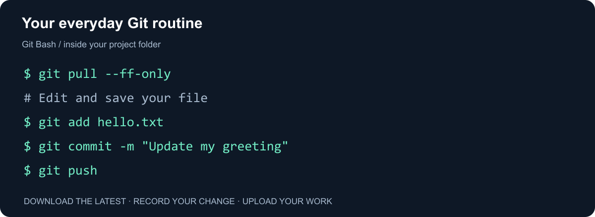
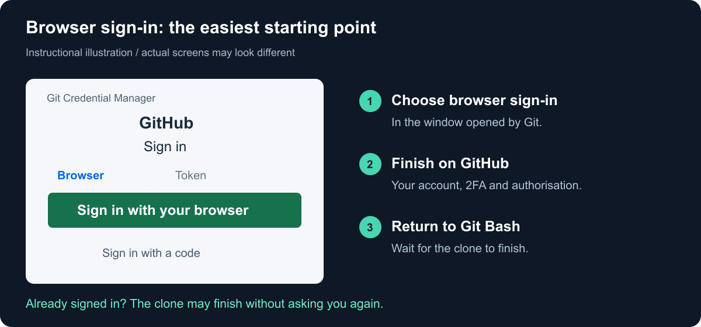
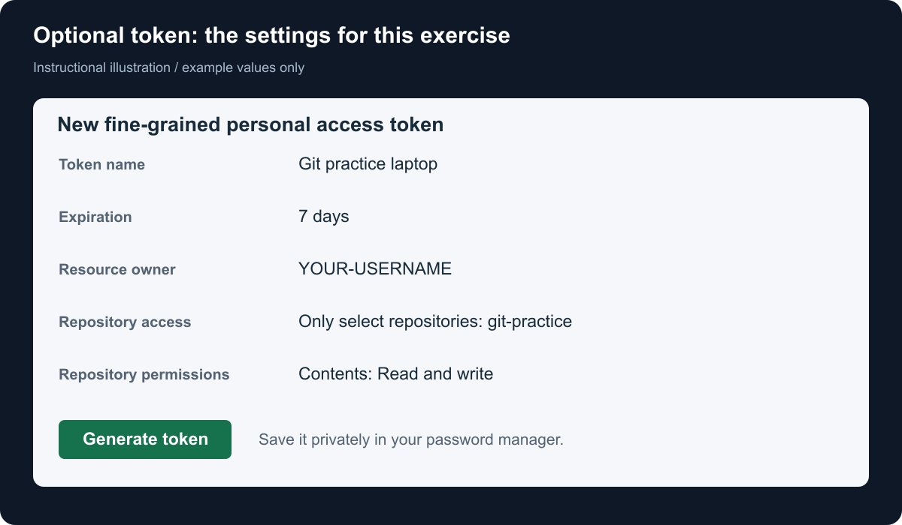
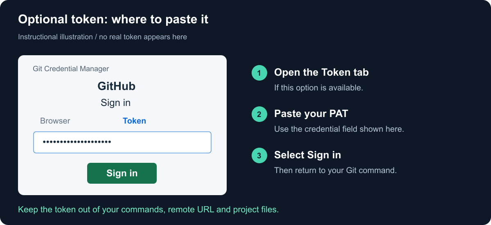

# Git: your first pull, commit and push

**A short, hands-on guide for your own computer.**

By the end, you will have downloaded a project, changed a file and uploaded your work to GitHub. We will use **Windows + Git Bash** and a small repository that belongs to you.



**Start here:** [Install](#1-install-git) · [Set your name](#2-set-your-name-once) · [Create a project](#3-create-your-practice-project) · [Sign in](#4-download-and-sign-in) · [Commit and push](#5-change-a-file-commit-and-push) · [Practise pull](#6-see-pull-in-action)

**Need help?** [Token setup](#optional-sign-in-with-a-token) · [Common problems](#when-something-goes-wrong) · [Daily reference](#your-everyday-routine)

> **How to read this guide:** copy commands from the code blocks, one line at a time. Blocks labelled “Example output” show what you might see; do not type them. Replace `YOUR-USERNAME` with your GitHub username. Stop if a command fails.

## The only ideas you need today

**Git** keeps a history of your project on your computer. **GitHub** keeps an online copy you can share. A **repository**, or *repo*, is a project with Git history.

| Command | Everyday meaning |
| --- | --- |
| `git clone` | Download a project for the first time. |
| `git pull` | Bring the latest online changes into your local copy. |
| `git add` | Choose which saved changes to include. |
| `git commit` | Record those changes in local history. |
| `git push` | Upload your commits to GitHub. |

**Saving a file, committing it and pushing it are separate steps.**

## 1. Install Git

1. Download [Git for Windows from the official website](https://git-scm.com/install/windows).
2. Run the installer. Keep **Git Bash**, command-line access and **Git Credential Manager** enabled. Choose an editor you recognise when asked.
3. Finish the installation, then open **Git Bash** from the Start menu.
4. Check that Git works:

```bash
git --version
```

**Success:** you see a version number. Its exact value does not matter for this exercise.

> Use **Git Bash** for the rest of this guide. You can keep your usual editor open beside it.

<details>
<summary>Using macOS or Linux instead?</summary>

On macOS, with Homebrew already installed:

```bash
brew install git
brew install --cask git-credential-manager
```

On Ubuntu or Debian:

```bash
sudo apt update
sudo apt install git
```

For Linux browser sign-in, also follow the [Git Credential Manager installation and credential-store instructions](https://github.com/git-ecosystem/git-credential-manager/blob/main/docs/install.md). Git alone may not include it. Use Terminal for the exercises.

</details>

## 2. Set your name once

Replace both example values:

```bash
git config --global user.name "Alex Student"
git config --global user.email "alex@example.com"
```

Use an email verified in your GitHub account, or copy your private `noreply` address from [GitHub email settings](https://github.com/settings/emails).

**This labels your commits. It does not sign you in.**

Check the saved values:

```bash
git config --global --get user.name
git config --global --get user.email
```

## 3. Create your practice project

Sign in to [GitHub](https://github.com), then open [New repository](https://github.com/new).

| Setting | Choose this |
| --- | --- |
| Owner | Your own account |
| Repository name | `git-practice` |
| Visibility | Private |
| Add README | On |

Click **Create repository**. You should see a `README.md` file.

> We create the README **on GitHub** and then clone the project. You do not need `git init` or `git remote add` for this route.

Use your own practice repository for these exercises. You may be able to download a teacher’s repository without having permission to push changes to it.

## 4. Download and sign in

In Git Bash, create a place for your projects:

```bash
mkdir -p ~/git-learning
cd ~/git-learning
```

On your GitHub repository page, choose **Code → Local → HTTPS**, then copy the URL. It should look like the one below.

Replace `YOUR-USERNAME`, then run:

```bash
git clone https://github.com/YOUR-USERNAME/git-practice.git
```

### The sign-in window

Because this repository is private, Git needs to authenticate. Git Credential Manager handles this on Windows.



*Instructional illustration, not a screenshot. Wording and layout can vary.*

1. Choose **Sign in with your browser** in the GitHub sign-in window.
2. In the browser, use the account that owns `git-practice`. Complete two-factor authentication if asked.
3. If GitHub asks you to authorise Git Credential Manager, review the request and authorise it.
4. When authentication succeeds, return to **Git Bash** and let the clone finish.

You usually do this once. GCM remembers credentials in Windows Credential Manager. No window may appear if you already signed in successfully. [Official sign-in guidance](https://docs.github.com/en/get-started/git-basics/caching-your-github-credentials-in-git).

Now enter the downloaded folder:

```bash
cd git-practice
git status
```

**Success:** Git recognises the repository and reports a clean working tree. The folder contains `README.md`.

**Browser sign-in worked? Continue below. You do not need to create a token.** If your setup requires one, use the [optional token instructions](#optional-sign-in-with-a-token).

## 5. Change a file, commit and push

### A. Get the latest version

Inside `git-practice`, run:

```bash
git pull --ff-only
```

You may see `Already up to date.` That is a successful result.

We use `--ff-only` so Git stops if local and online history have diverged, instead of choosing how to combine them. See [the recovery note](#when-something-goes-wrong) if it stops.

### B. Make a tiny change

This command creates a new file called `hello.txt`:

```bash
printf "Hello! I am learning Git.\n" > hello.txt
```

You can also create that file in your editor. Save it inside `git-practice`.

```bash
git status
```

**Example output** (abbreviated):

```text
Untracked files:
  hello.txt
```

“Untracked” means Git has found the file but has not added it to history yet.

### C. Choose the file and record the change

```bash
git add hello.txt
git diff --staged
```

Read the change. If a pager opens, press `q` to leave it. Then commit:

```bash
git commit -m "Add my first greeting"
```

**Success:** Git reports a new commit. It exists on your computer. It has not reached GitHub yet.

### D. Upload your commit

```bash
git push
```

Refresh your repository page on GitHub. Open `hello.txt`.

**You should see:** `Hello! I am learning Git.`

That is your first complete cycle: **change → add → commit → push**.

## 6. See pull in action

Let’s make the online copy change so you can download something new.

1. On **GitHub**, open `hello.txt` and click the pencil icon to edit it.
2. Add a second line: `This line was added on GitHub.`
3. Choose **Commit changes**, enter `Add a line online`, and commit directly to the current branch in this personal practice repository.
4. Return to Git Bash. Do not edit the local file yet.

```bash
git pull --ff-only
cat hello.txt
```

**Expected file content:**

```text
Hello! I am learning Git.
This line was added on GitHub.
```

**That is what pull does:** it brings online changes into your local project.

## Your everyday routine

Run these inside your project folder. **Edit and save your files after the pull and before the add.**

```bash
# 1. Check for unfinished work
git status

# 2. Start with the latest version
git pull --ff-only

# 3. Edit and SAVE hello.txt in your editor

# 4. Review your edits
git diff

# 5. Choose the file and record the change
git add hello.txt
git commit -m "Explain what changed"

# 6. Upload the commit
git push
```

Replace `hello.txt` with the file you actually changed. For a notebook, for example: `git add analysis.ipynb`. Review notebook outputs before sharing them. Keep tokens, private data and `.env` files out of commits.

> **Clone once. Pull before starting. Commit meaningful changes. Push when ready to share.** If `git status` shows unfinished work at the start, finish and commit it before pulling, or ask your teacher for help.

### A two-minute challenge

Add `I can now pull, commit and push.` to `hello.txt` on your computer. Commit and push it, then check GitHub.

<details>
<summary>Show one possible solution</summary>

```bash
git pull --ff-only
printf "I can now pull, commit and push.\n" >> hello.txt
git diff
git add hello.txt
git commit -m "Record my Git progress"
git push
git status
```

`>>` appends a line. `>` replaces a file’s contents, which is why we only used it when creating the new file. A clean status means no uncommitted changes. Check GitHub to confirm the upload.

</details>

## Optional: sign in with a token

**Use this only if you need manual token authentication.** A personal access token (PAT) acts as a credential for HTTPS Git operations. Never share it.

### A. Create the token

Open [GitHub’s fine-grained token settings](https://github.com/settings/personal-access-tokens), then **Generate new token**. The menu route is **Settings → Developer settings → Personal access tokens → Fine-grained tokens**.



*Instructional illustration. Example values only.*

Choose a descriptive name, a short expiry, your own account as owner, and only `git-practice`. Give **Contents** permission **Read and write**. Generate the token and save it in a password manager. Organisations may require approval. [Official token guide](https://docs.github.com/en/authentication/keeping-your-account-and-data-secure/managing-your-personal-access-tokens).

### B. Use it in Git Credential Manager

Retry the clone from step 4. If GCM offers a **Token** tab, open it, paste your PAT and select **Sign in**. GCM handles storage for later use.



*Illustration based on the [GCM sign-in interface](https://github.com/git-ecosystem/git-credential-manager/blob/main/src/GitHub/UI/Views/CredentialsView.axaml). Available options depend on your setup.*

If Git shows a terminal password prompt instead, use your username and paste the PAT at **Password**. The token may remain invisible while you paste. Press Enter. Your GitHub account password will not work for HTTPS Git authentication.

**Example prompts only:**

```text
Username for 'https://github.com': YOUR-USERNAME
Password for 'https://YOUR-USERNAME@github.com': [paste token here]
```

Never put the token in a command, repository URL or file. Avoid `credential.helper store`, which saves plaintext credentials. If the token expires, replace it. If it leaks, revoke it immediately.

<details>
<summary>No Token tab? Test the token once from Git Bash</summary>

This temporarily bypasses credential helpers and does not save the token. Replace the username and run it from `~/git-learning`. Use a separate folder so you do not overwrite the first clone:

```bash
cd ~/git-learning
git -c credential.helper= clone https://github.com/YOUR-USERNAME/git-practice.git git-practice-token
cd git-practice-token
```

Enter your username and use the PAT at the password prompt. Continue the exercises in this new folder. For later commands, return to browser sign-in or use GCM’s Token tab to remember credentials securely.

</details>

## When something goes wrong

| What you see | What to do |
| --- | --- |
| `git` is not recognised | Close and reopen Git Bash after installation. If needed, reinstall Git with command-line access. |
| `Author identity unknown` | Repeat the two configuration commands in step 2. |
| `not a git repository` | Enter the project: `cd ~/git-learning/git-practice`. Use the token folder instead if you chose that route. |
| `nothing to commit` | Save your file. Run `git status`. Stage the changed file. If nothing changed, no commit is needed. |
| `Authentication failed` | Check your account or token expiry. See the saved-login reset below. |
| `Repository not found` or `403` | Check the URL and account. You need access to the repository and write permission to push. |
| Clone destination already exists | If the earlier clone succeeded, enter that folder. Otherwise choose a new folder name after checking the old one. |
| Push rejected, or pull cannot fast-forward | Online and local changes may need combining. Follow the note below. |

### Reset a saved Windows login

Open **Start → Credential Manager → Windows Credentials**. Find the GitHub credential for the account you need to reset. Remove only that entry, then retry your Git command and sign in again. This removes the saved login, not your project files. [GitHub’s reset instructions](https://docs.github.com/en/get-started/git-basics/caching-your-github-credentials-in-git).

### A rejected push

If another change reached GitHub first, try `git pull --ff-only`. If it succeeds, retry `git push`.

If Git says it cannot fast-forward, **stop and ask your teacher to help combine the histories**. Your work is still present. Do not use `--force`, delete the folder or run `reset --hard` as a shortcut. Team repositories may also require a pull request instead of a direct push.

## Ready to use Git

- [ ] I can clone my own repository and sign in.
- [ ] I can pull a change made on GitHub.
- [ ] I can change a file, add it and commit it.
- [ ] I can push and find the new content on GitHub.

You can now use this same routine for your class projects. Branches and pull requests can come in the next lesson.

---

**References:** [Git installation](https://git-scm.com/install/windows) · [Git basics](https://git-scm.com/book/en/v2/Git-Basics-Recording-Changes-to-the-Repository) · [Pull behaviour](https://git-scm.com/docs/git-pull) · [Credential storage](https://git-scm.com/docs/git-credential-store). Authentication links appear beside the relevant steps. Interface guidance checked in October 2026.
